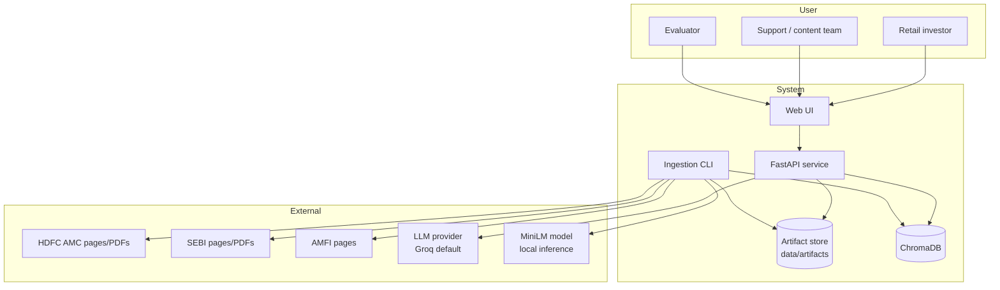
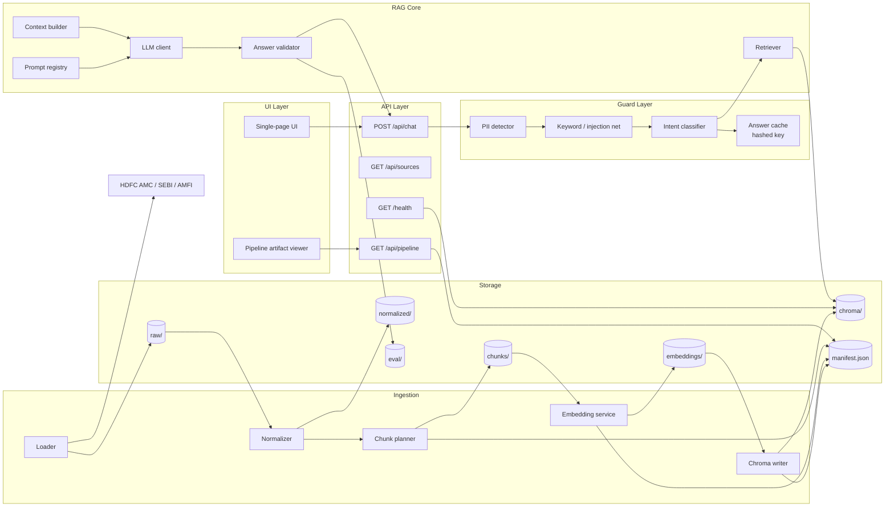
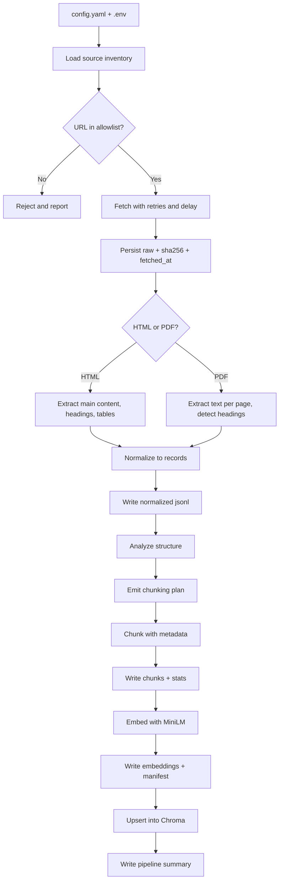
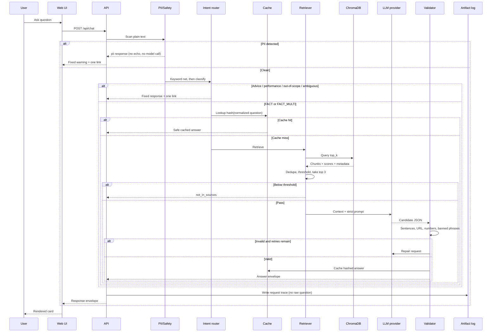
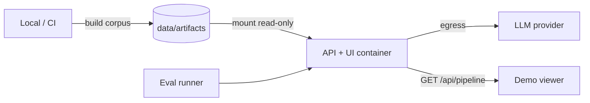

# Architecture — HDFC MF Facts Assistant (RAG FAQ Prototype)

| Field | Value |
|---|---|
| Product | HDFC MF Facts — facts-only Mutual Fund FAQ assistant |
| Milestone | M4 / GrowChatbot |
| Version | 1.0 (draft) |
| Date | 2026-11-01 |
| Derived from | `GrowChatbot/PRD.md` v1.0 |
| Status | Draft for review |

---

## 1. Architectural Goals

1. **Official-source grounding.** Every answer is composed only from allowlisted HDFC AMC / SEBI / AMFI text and cites exactly one URL that exists in the retrieved chunk metadata.
2. **Inspectable RAG.** Each stage writes durable artifacts, so loading, chunking, embedding, storage, retrieval, and generation can be demonstrated independently.
3. **Config-driven.** Chunking, embedding model, vector store, retrieval thresholds, and LLM provider/model are runtime configuration, not code.
4. **Safety before intelligence.** PII and safety routing execute in plain code before any model call.
5. **Failure is safe.** Any retrieval, provider, or validation failure degrades to `not_in_sources` or `error`, never to an uncited or invented answer.

Non-goals: advice, performance comparison, account data, authentication, conversation persistence, live NAV trading feed.

---

## 2. System Context



Runtime is two processes:
- **Ingestion CLI** — offline, scheduled, idempotent. Builds the corpus and vector collection.
- **API + UI** — online, read-only against ChromaDB. Never mutates the corpus.

---

## 3. Component Architecture



---

## 4. Module Responsibilities

| Module | Responsibility | Key outputs |
|---|---|---|
| `src/config.py` | Load/validate YAML + env; fail fast on bad values | Typed config object |
| `src/ingest/loader.py` | Fetch allowlisted URLs, retries, checksum, timestamps | `raw/*`, `raw/manifest.json` |
| `src/ingest/normalize.py` | HTML/PDF to structured text with section/page markers | `normalized/*.jsonl` |
| `src/ingest/chunk.py` | Structural analysis, strategy selection, chunk emission | `chunks/chunks.jsonl`, `chunking_plan.json`, `chunk_stats.json` |
| `src/ingest/embed.py` | MiniLM batching, normalization, manifest | `embeddings/embeddings.npy`, `ids.json`, `embedding_manifest.json` |
| `src/store/chroma.py` | Collection lifecycle, upsert, metadata, filters | Persistent Chroma dir |
| `src/rag/retrieve.py` | Query embedding, top-k, dedupe, filtering | Ranked chunk list + debug trace |
| `src/rag/generate.py` | Prompt assembly, provider call, JSON parsing | Candidate answer |
| `src/rag/validate.py` | Sentence/URL/number/banned-phrase checks, repair loop | Valid answer or fallback type |
| `src/safety/pii.py` | Regex + validators (PAN, Aadhaar, phone, email, OTP, account) | `pii` hit with no echo |
| `src/safety/intent.py` | Safety keyword net + LLM JSON classification | `FACT`, `FACT_MULTI`, `ADVICE`, `PERFORMANCE`, `OUT_OF_SCOPE`, `AMBIGUOUS`, `PII` |
| `src/api/main.py` | Routes, envelope serialization, request ids | HTTP responses |
| `ui/` | Landing, chat states, disclaimer, pipeline viewer | Rendered UI |
| `eval/` | Gold set, retrieval/answer/safety runners | `data/eval/*.json` |

---

## 5. Ingestion Pipeline

### 5.1 Flow



### 5.2 Stage contracts

**Stage 1 — Load**

- Input: `sources.csv` (or config-embedded inventory) with `url, publisher, doc_type, scheme, expected_topics`.
- Behavior: HTTP GET with timeout, 3 retries, jittered backoff, `request_delay_ms`; record status, content type, bytes, sha256, `fetched_at`.
- Output: `data/artifacts/raw/manifest.json`, raw files under `raw/`.
- Failure: log and continue; manifest marks source as `failed` with reason; coverage report will surface gaps.

**Stage 2 — Normalize**

- HTML: readability-style extraction, preserve heading hierarchy, tables converted to markdown.
- PDF: page-level extraction, heading detection, page markers retained.
- Output record: `source_id, url, publisher, doc_type, scheme, title, as_on_date, section_path, page, text`.
- `as_on_date`: printed document date if present, else `null`; retrieval date is stored separately as `fetched_at`.

**Stage 3 — Chunk**

- Planner inspects `section_path` depth, paragraph/table density, and document type.
- Strategy selection recorded in `chunking_plan.json`:
  - `section_aware_recursive` (default fallback) — target 800 tokens, overlap 120.
  - `table_preserving` — tables never split across chunks.
  - `fixed_window` — only for documents with no usable structure.
- Chunk ID: `sha1(source_id + section_path + normalized_text)[:16]`.
- Topic tagging: keyword/vocabulary map per chunk for `expense_ratio, exit_load, min_sip, elss_lockin, riskometer, benchmark, statements, definitions`, plus a `general` default.

**Stage 4 — Embed**

- `sentence-transformers/all-MiniLM-L6-v2`, batch size from config, L2-normalized, 384 dimensions.
- Manifest records model, revision, dimension, chunk count, corpus version, timestamp.
- Re-run determinism check: same corpus and model produces same count and manifest hash.

**Stage 5 — Store**

- Chroma persistent client, `cosine` distance, collection from config.
- Metadata per vector: `chunk_id, source_id, url, publisher, doc_type, scheme, topic, as_on_date, section, page, text_hash`.
- Collection metadata stores `embedding_model`, `dimension`, `corpus_version`, `ingested_at`.
- Modes: `rebuild` (drop + recreate) and `upsert` (idempotent by `chunk_id`).

### 5.3 Idempotency and versioning

- Corpus version = hash of sorted `(source_id, sha256)` pairs.
- Re-ingesting an unchanged corpus produces identical chunk IDs and manifest; no duplicate vectors.
- Changing chunking or embedding config produces a new corpus version and requires an explicit rebuild.

---

## 6. Query Pipeline

### 6.1 Sequence



### 6.2 Guard order (hard requirement)

1. **PII in plain code.** No model call, no cache, no raw-question logging on hit.
2. **Keyword safety net.** Advice/performance phrases and injection markers short-circuit before the classifier.
3. **Intent classification.** LLM returns JSON only; malformed output falls back to keyword result.
4. **Retrieval.** Only for `FACT` / `FACT_MULTI`.
5. **Composition.** Only retrieved context is allowed.
6. **Validation.** Deterministic checks, one repair retry, then `not_in_sources`.
7. **Cache.** Only validated factual answers, keyed by salted hash.

### 6.3 Intent routing table

| Signal | Route | Model called? |
|---|---|---|
| PAN/Aadhaar/phone/email/OTP/account pattern | `pii` | No |
| "should I buy/sell", "which is better", "recommend" | `refusal_advice` | No |
| "returns", "performance", "CAGR", "compare" | `refusal_performance` | No |
| "ignore instructions", "system prompt", role-play override | Safe refusal / `not_in_sources` | No |
| Fact with no scheme, scheme-dependent topic | `clarify` | No |
| Fact with scheme or scheme-independent topic | `answer` | Yes |
| Multiple schemes in one question | `answer` for first + chip | Yes |
| No supporting chunk above threshold | `not_in_sources` | Optional |
| Provider/validator failure after retry | `not_in_sources` or `error` | Yes |

### 6.4 Retrieval design

- Query embedding uses the **same** model and normalization as ingestion; startup compares collection metadata and fails closed on mismatch.
- `top_k=5`, `score_threshold=0.35`, `max_context_chunks=3` (all configurable).
- Dedupe by `text_hash` and near-duplicate text; prefer specific document types (`kim`, `sid`, `factsheet`, `scheme_page`) over `catalogue`.
- Optional metadata filter by scheme chip; never filter away scheme-independent topics like statement downloads.
- Retrieval trace persisted per request: chunk id, score, url, section (no raw question).

### 6.5 Prompt assembly

System prompt responsibilities:
- Answer only from provided context.
- Maximum 3 sentences.
- Exactly one URL chosen from provided chunk metadata.
- No advice, no returns, no comparisons.
- No numbers absent from context.
- If context is insufficient, return `not_in_sources`.
- Return strict JSON matching the envelope.

Context block contains, per chunk: `chunk_id`, `publisher`, `doc_type`, `scheme`, `section`, `as_on_date`, `url`, `text`. Retrieved text is wrapped as data, not instructions.

### 6.6 Validation rules

| Check | Failure behavior |
|---|---|
| `answer` sentence count <= 3 | Repair, then `not_in_sources` |
| Exactly one URL | Repair |
| URL in allowlist and in retrieved chunk metadata | Repair |
| No banned advice/performance phrases | Repair, then fixed refusal |
| Every number appears in context | Repair, then `not_in_sources` |
| `proof` is a verbatim substring of a retrieved chunk | Repair |
| PII pattern in output | Replace with `pii` response |

---

## 7. Data Model

### 7.1 Artifact store

```
data/artifacts/
  raw/
    manifest.json                 # url, publisher, sha256, fetched_at, status
    <source_id>.<ext>
  normalized/
    <source_id>.jsonl             # section/page-level text records
  chunks/
    chunking_plan.json            # strategy, params, rationale, corpus_version
    chunks.jsonl                  # one chunk per line
    chunk_stats.json              # counts, token distribution, topic coverage
  embeddings/
    embeddings.npy
    ids.json
    embedding_manifest.json
  chroma/                         # persistent ChromaDB
  eval/
    retrieval_eval.json
    qa_eval.json
    safety_eval.json
  traces/
    requests.jsonl                # request_id, type, chunk ids, latency (no raw text)
```

### 7.2 Core records

```text
Source   : source_id, url, publisher, doc_type, scheme, title, as_on_date,
           fetched_at, sha256, status, local_path
Chunk    : chunk_id, source_id, url, publisher, doc_type, scheme, topic,
           section, page, text, token_count, text_hash
VectorMd : chunk_id, source_id, url, publisher, doc_type, scheme, topic,
           as_on_date, section, page, text_hash
Response : type, answer, source_url, source_name, as_on_date, proof,
           can_do[], chunks_used[], request_id
Trace    : request_id, type, latency_ms, chunks_used[], validator_result,
           cache_hit (no question text)
```

No schema field stores a user question, PII, or conversation history.

---

## 8. API Design

| Method | Path | Purpose |
|---|---|---|
| `POST` | `/api/chat` | Ask a question |
| `GET` | `/api/sources` | List allowlisted source inventory |
| `GET` | `/api/pipeline` | Stage artifact summaries for demo |
| `GET` | `/api/pipeline/{stage}` | Detail for `load`, `chunk`, `embed`, `store`, `retrieve` |
| `GET` | `/health` | Config, provider, collection status |
| `GET` | `/` | Single-page UI |

**Request**

```json
{ "question": "string", "scheme": "large_cap | flexi_cap | elss | mid_cap | null" }
```

**Response** — identical envelope for every type (PRD section 7.2), with `type` driving the UI card.

Status codes: `200` for all handled outcomes including refusals; `400` malformed payload; `422` empty question; `503` when collection or provider is unavailable.

---

## 9. Configuration and Environment

- `config.yaml` holds all stage parameters (PRD section 9).
- `.env` holds secrets only: `GROQ_API_KEY`, `GEMINI_API_KEY`, `OPENAI_API_KEY`, `ANTHROPIC_API_KEY`, `MISTRAL_API_KEY`, `LLM_MODEL_ID`.
- `.env.example` documents the keys with empty values; `.env` is git-ignored.
- Startup validation:
  1. Required config keys present and in range.
  2. Selected provider key present.
  3. Model ID resolvable (no hardcoded default model).
  4. Chroma collection exists and embedding manifest matches config.
  5. Fail closed with an actionable error if any check fails.

Provider abstraction uses one interface: `classify(prompt, schema) -> dict` and `compose(context, question) -> dict`, so providers are interchangeable behind config.

---

## 10. Deployment



- **Prototype target:** single machine, two commands — `python -m src.ingest` then `uvicorn src.api.main:app`.
- **Container:** one image, artifacts mounted or baked at build; API read-only on the corpus.
- **Reverse proxy:** optional; HTTPS required if exposed publicly.
- **Fallback:** if hosting is unavailable, record a <=3-minute demo video using the local UI.
- **Cold start:** embedding model is loaded once at API start; health check reports readiness.

---

## 11. Observability

- Structured JSON logs: request id, route, response type, latency, validator outcome, chunk ids.
- **Never** log raw questions, answers containing PII, or provider request bodies.
- `/health` reports: config hash, embedding model, collection count, corpus version, provider name, model ID.
- Pipeline summary exposes counts per stage for the demo viewer.
- Eval artifacts are the primary quality signal; no live dashboards required for this milestone.

---

## 12. Security and Privacy Controls

| Control | Implementation |
|---|---|
| PII never stored | No schema field; regex pre-check; no raw-question logging |
| PII never echoed | Fixed response text; input string not interpolated |
| Secrets | Env only; never in frontend, config, repo, logs, or DB |
| Source integrity | Allowlist publishers; sha256 per source; URL validated against inventory |
| Prompt injection | Retrieved text wrapped as data; rules in system prompt; keyword net |
| Answer integrity | Deterministic validator; number grounding; repair then fallback |
| Least privilege | API read-only on Chroma; ingestion is a separate process |
| Honest disclosure | Document free-tier provider retention and platform logging behavior |

---

## 13. Reliability and Failure Modes

| Failure | Behavior |
|---|---|
| Source fetch fails during ingest | Mark `failed`, continue; coverage report lists gaps |
| PDF/HTML extraction empty | Mark source `unusable`; exclude from report and alert |
| Embedding model mismatch at startup | Refuse to serve; explain fix |
| Chroma missing/empty | `/health` degraded; `/api/chat` returns `503` |
| Provider timeout/error | One retry, then `not_in_sources` or `error` |
| Classifier returns invalid JSON | Fall back to keyword routing, then safe default |
| Validator fails twice | `not_in_sources` with scheme-documents link |
| Low retrieval score | `not_in_sources`, no model composition |
| Cache poisoning attempt | Cache key is salted hash of normalized question; values are validated envelopes only |

---

## 14. Testing Strategy

| Layer | Tests |
|---|---|
| Unit | PII regex, intent keywords, chunk ID stability, validator rules, config validation |
| Ingestion | Manifest completeness, normalization non-empty, chunk coverage per topic, embedding count equality |
| Store | Idempotent rebuild, metadata filter correctness, dimension check |
| Retrieval | Expected source/topic appears in top-k for gold questions |
| API | Envelope schema for all seven types, status codes, no PII echo |
| Safety | Advice, performance, PII, injection, out-of-scope, ambiguous |
| End-to-end | PRD acceptance criteria A1–A16 |
| Regression | `data/eval/qa_eval.json` diffs against baseline |

Commands: `pytest tests/`, `python -m eval.run --suite all`.

---

## 15. Key Design Decisions

| ID | Decision | Rationale | Trade-off |
|---|---|---|---|
| AD1 | ChromaDB persistent local store | Minimal ops, inspectable for a demo | Not horizontally scalable |
| AD2 | MiniLM-L6-v2 | Small, fast, CPU-friendly, same model for ingest and query | Weaker than large embedding models |
| AD3 | Artifact-first pipeline | Satisfies "show each stage" requirement | More disk and orchestration code |
| AD4 | Plain-code safety before LLM | Deterministic, no PII exposure to provider | Keyword rules need maintenance |
| AD5 | Exactly one citation | Matches product constraint; reduces ambiguity | Multi-source answers must be split |
| AD6 | Validator + single repair | Bounds cost and enforces contract | Some answerable questions may fall back |
| AD7 | Provider-agnostic LLM client | Config switch across Groq/Gemini/OpenAI/Anthropic/Mistral | Lowest-common-denominator API surface |
| AD8 | Hashed cache only | Avoids storing user questions | No conversational memory |
| AD9 | Groww used for discovery only | Preserves official-source policy | Scheme mapping must be verified against AMC pages |

---

## 16. Mapping to PRD Requirements

| PRD section | Architecture coverage |
|---|---|
| 6.1 Corpus scope | §5.2 loader allowlist, §7.1 manifest |
| 6.3 Question classes | §6.3 routing table |
| 7.1 UI states | §3 UI layer, §8 response envelope |
| 7.2 Answer contract | §6.6 validator, §7.2 `Response` |
| 7.3 Processing order | §6.2 guard order |
| 7.4 Citation rules | §6.4, §6.6, §7.2 vector metadata |
| 8 Phased delivery | §5 ingestion stages, §6 query pipeline |
| 9 Configuration | §9 |
| 10 Architecture | §2, §3, §4 |
| 11 Data contracts | §7 |
| 12 Safety | §6.2, §12 |
| 13 Acceptance criteria | §14 testing, §16 traceability |
| 15 Milestones | §5, §6, §10 deployment |

---

## 17. Repository Layout

```
GrowChatbot/
  PRD.md
  Architecture.md
  config.yaml
  .env.example
  requirements.txt
  src/
    config.py
    ingest/
      loader.py
      normalize.py
      chunk.py
      embed.py
    store/
      chroma.py
    rag/
      retrieve.py
      generate.py
      validate.py
      prompts.py
    safety/
      pii.py
      intent.py
    api/
      main.py
      schemas.py
  ui/
    index.html
    app.js
    styles.css
  eval/
    gold_questions.csv
    run.py
  tests/
  data/artifacts/          # generated, not committed
  sources.csv
  README.md
  sample_qa.md
```

---

## 18. Open Architecture Questions

These mirror PRD section 16 and block final sign-off:

1. **Source policy (O1):** confirm citations are HDFC AMC/SEBI/AMFI only, with Groww used solely for discovery.
2. **Scheme count (O2):** include HDFC Small Cap Fund or freeze scope at four schemes.
3. **Model ID (O3):** confirm the current Groq model identifier to place in `LLM_MODEL_ID`; the instruction's `qwen/qwen3.8-27b` is unverified.
4. **Chunk planner (O4):** rule-based planner with recorded rationale (default) versus optional LLM-assisted planner.
5. **Refresh cadence (O5):** recommended weekly re-ingest for dynamic facts such as TER and exit load.
6. **Hosting (O6):** local demo with video fallback versus a hosted single-page deployment.
