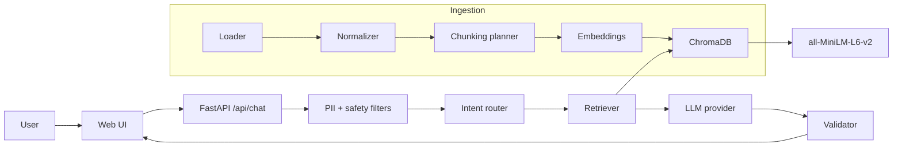

# PRD — HDFC MF Facts Assistant (RAG FAQ Prototype)

| Field | Value |
|---|---|
| Product | HDFC MF Facts — facts-only Mutual Fund FAQ assistant |
| Milestone | M4 / GrowChatbot |
| Version | 1.0 (draft) |
| Date | 2026-11-01 |
| Source input | `GrowChatbot/instructiondoc` |
| Related assets | `HDFC_MF_Five_Scheme_Corpus_Pack_2026-10-20/`, `ChatGPT_Hatchable_HDFC_MF_Facts_Gemini_Free_API_Prompt_Pack.md` |
| Status | Draft for review |

---

## 1. Summary

Build a working RAG prototype that answers factual questions about HDFC Mutual Fund schemes, using only official public sources. Every answer must carry exactly one citation link and a "last updated" date. The assistant must refuse investment-advice, performance-comparison, and personal-data requests.

The prototype is also a teaching artifact: each RAG stage (loading, chunking, embedding, vector storage, retrieval, generation) must persist its inputs and outputs explicitly so the pipeline can be inspected and demonstrated stage by stage. All stage parameters live in a config file and can be changed without code edits.

---

## 2. Problem and Context

Retail investors and support/content teams repeatedly ask the same factual questions: expense ratio, exit load, minimum SIP, ELSS lock-in, riskometer, benchmark, and statement downloads. Answers are scattered across AMC pages, KIM/SID PDFs, factsheets, and regulator pages. Generic chatbots answer these from memory, which risks stale or fabricated numbers, and they frequently drift into advice.

This product constrains the model to a small, curated, official corpus, forces a citation, and explicitly refuses anything that is opinion, recommendation, or performance comparison.

### 2.1 Source-material conflict to resolve

The instruction document lists **Groww** pages to scrape. Groww is a distributor/aggregator, not an official source, and the stated constraints and the existing corpus pack require **official public pages only** (HDFC AMC, SEBI, AMFI). The PRD therefore treats Groww URLs as **discovery aids only** (scheme naming and mapping) and cites only HDFC AMC / SEBI / AMFI pages. See Open Question O1.

---

## 3. Goals and Success Metrics

| Goal | Metric | Target |
|---|---|---|
| Factual accuracy | Correct answer on curated gold set | >= 90% |
| Citation validity | Answers whose single link actually supports the claim | 100% |
| Safety routing | Correct refusal/clarify on PII, advice, performance, out-of-scope set | 100% |
| Grounding | Answers containing numbers absent from retrieved context | 0 |
| Response contract | Answers with >3 sentences or !=1 URL | 0 |
| Latency | p95 end-to-end for a factual question | < 8 s |
| Privacy | Raw user questions persisted or logged | 0 |
| Demonstrability | Pipeline stages inspectable from stored artifacts | All 6 stages |

---

## 4. Non-Goals

- No investment advice, recommendations, buy/sell/hold guidance, or portfolio analysis.
- No return computation, comparison, ranking, or performance claims.
- No account-specific data (folio, PAN, Aadhaar, bank, OTP, email, phone) collection or storage.
- No user authentication, persistence of conversations, or multi-user analytics.
- No live NAV or live TER trading feed; dynamic facts are refreshed on a defined schedule and date-stamped.
- No multilingual UI, voice, or mobile app in this milestone.
- No production-grade security certification or zero-retention guarantee.

---

## 5. Users

| Persona | Need |
|---|---|
| Retail investor comparing schemes | Fast, cited answers to factual scheme questions |
| Support / content team | A reusable, auditable answer source for repetitive MF queries |
| Evaluator / instructor | Visibility into each RAG stage and evidence that citations are grounded |

---

## 6. Scope

### 6.1 Corpus scope

| # | Source | Instruction URL | Use |
|---|---|---|---|
| 1 | HDFC Mutual Fund AMC overview | `https://groww.in/mutual-funds/amc/hdfc-mutual-funds` | Discovery only; cite HDFC AMC equivalent |
| 2 | HDFC Large Cap Fund Direct Growth | `https://groww.in/mutual-funds/hdfc-large-cap-fund-direct-growth` | Discovery only; cite HDFC AMC scheme page/KIM/SID/factsheet |
| 3 | HDFC Flexi Cap Direct Plan Growth | `https://groww.in/mutual-funds/hdfc-equity-fund-direct-growth` | Discovery only; cite HDFC AMC scheme page/KIM/SID/factsheet |
| 4 | HDFC ELSS Tax Saver Fund Direct Plan Growth | `https://groww.in/mutual-funds/hdfc-elss-tax-saver-fund-direct-plan-growth` | Discovery only; cite HDFC AMC scheme page/KIM/SID/factsheet |
| 5 | HDFC Mid Cap Fund Direct Growth | `https://groww.in/mutual-funds/hdfc-mid-cap-fund-direct-growth` | Discovery only; cite HDFC AMC scheme page/KIM/SID/factsheet |

Allowlisted publishers: **HDFC AMC, SEBI, AMFI**. Target 15–25 canonical URLs. The existing corpus pack adds a fifth scheme (HDFC Small Cap Fund); inclusion is pending confirmation (Open Question O2).

### 6.2 Topic scope

Expense ratio / TER, exit load, minimum SIP, minimum lump sum, ELSS 3-year lock-in, riskometer, benchmark, account-statement download, capital-gains-statement download, and definitions of NAV/SIP/exit load/expense ratio/riskometer.

### 6.3 Question classes

| Class | Behavior |
|---|---|
| `FACT` | Answer from retrieved context, one citation |
| `FACT_MULTI` | Answer for the first scheme; offer chip for the other |
| `ADVICE` | Polite refusal + educational official link |
| `PERFORMANCE` | Refusal + factsheet catalogue link |
| `OUT_OF_SCOPE` | "Not in my sources" + scheme-documents link |
| `AMBIGUOUS` | Clarify with scheme chips + one link |
| `PII` | Fixed warning, never echo the question |

---

## 7. Functional Requirements

### 7.1 UI (single page)

- Header: `HDFC MF Facts`.
- Persistent note: `Facts-only. No investment advice.`
- Welcome line: `Hi! Ask me facts about HDFC Mutual Fund schemes.`
- Three tappable example questions:
  1. `What is the exit load of HDFC Flexi Cap Fund?`
  2. `What is the lock-in period of HDFC ELSS Tax Saver?`
  3. `How do I download my capital-gains statement?`
- Free-text input with helper text: `No personal info please (PAN, Aadhaar, phone, email, OTP).`
- Optional scheme filter chips: Large Cap, Flexi Cap, ELSS Tax Saver, Mid Cap (Small Cap if approved).
- Answer card shows: answer (<=3 sentences), exactly one official link, `Last updated from sources: <date>`, and a collapsible `Show me the proof` with the exact supporting passage.
- Loading state text: `Checking the official documents…`
- Footer disclaimer as defined in section 12.
- A read-only "Pipeline" panel or separate route exposing stage artifact summaries for demo purposes (counts, chunk plan, sample chunks, embedding model, collection stats). No raw user questions.

### 7.2 Answer contract

All API responses use one envelope:

```json
{
  "type": "answer | refusal_advice | refusal_performance | not_in_sources | clarify | pii | error",
  "answer": "string (<=3 sentences, answer/refusal types)",
  "source_url": "https://... or null",
  "source_name": "HDFC AMC | SEBI | AMFI | null",
  "as_on_date": "YYYY-MM-DD or null",
  "proof": "exact retrieved passage or null",
  "can_do": ["suggested question", "..."],
  "chunks_used": ["chunk_id", "..."],
  "request_id": "opaque id"
}
```

Rules:
- `answer`, `not_in_sources`, `clarify`, `pii`, and refusals each carry exactly one link, except `error`.
- `error` carries fixed text and no link.
- `proof` is copied verbatim from retrieved chunk text, never generated.
- `as_on_date` comes from source metadata, never inferred from URL or crawl date.
- No field may echo a detected PII string.

### 7.3 Processing order

1. PII check in plain code (regex + validators). No model call, no logging of raw input on hit.
2. Safety keyword net / prompt-injection check.
3. Intent classification (LLM, JSON-only) when not short-circuited.
4. Retrieval for `FACT` / `FACT_MULTI`.
5. Grounded composition from top chunks only.
6. Deterministic validator before returning.
7. Cache safe factual answers by one-way hash of normalized question only.

### 7.4 Citation rules

- Exactly one URL per non-error response.
- URL must be in the allowlisted source inventory and present in the retrieved chunk metadata.
- Prefer the most specific official document (KIM/SID/factsheet/scheme page) over a catalogue page when both support the answer.
- Display publisher name and `Last updated from sources: <as_on_date>`; if the document has no printed date, use `retrieved on <download_date>`.

### 7.5 Refusal behavior

- Advice ("Should I buy/sell?", "Which is better?"): one polite facts-only sentence + educational official link + three answerable suggested questions.
- Performance/returns: state that returns are not computed or compared + factsheet catalogue link.
- Out-of-scope fact: state it is not covered by the curated sources + scheme-documents link.
- Ambiguous: ask which scheme + scheme chips + one link.
- PII: fixed warning, do not repeat the input, no AI call, no persistence.

---

## 8. Phased Delivery (explicit per-stage artifacts)

Every stage writes durable artifacts under `data/artifacts/` so the demo can show the pipeline, not just the chatbot.

```
data/
  raw/            # downloaded HTML/PDF + manifest.json (url, sha256, fetched_at)
  normalized/     # extracted text with section/page markers (.jsonl or .md)
  chunks/         # chunks.jsonl + chunking_plan.json + chunk_stats.json
  embeddings/     # embeddings.npy + ids.json + embedding_manifest.json
  chroma/         # persistent ChromaDB directory
  eval/           # retrieval_eval.json, qa_eval.json, safety_eval.json
  cache/          # hashed answer cache (optional)
```

### Phase 0 — Configuration and scaffolding

- `config.yaml` (or `.env` + `config.yaml`) defines all stage parameters.
- Secrets only via environment: `GROQ_API_KEY`, `GEMINI_API_KEY`, `OPENAI_API_KEY`, `ANTHROPIC_API_KEY`, `MISTRAL_API_KEY`.
- Startup validates config, model availability, embedding model identity, and collection metadata.
- **Exit:** app boots with no sources and reports a clear "ingest first" state.

### Phase 1 — Data loading

- Fetch allowlisted URLs; handle HTML and PDF; retry with backoff; record HTTP status, content type, SHA-256, fetch timestamp.
- Persist `raw/manifest.json` and `normalized/*.jsonl` with `source_id, url, publisher, doc_type, scheme, title, as_on_date, section, page, text`.
- Respect robots/terms; low request rate; no authenticated pages.
- **Exit:** every allowlisted source has a manifest row and normalizes to non-empty text.

### Phase 2 — Data chunking

- A chunking planner inspects document structure (headings, tables, PDF page/section) and emits `chunking_plan.json` with chosen strategy, parameters, and rationale.
- Default fallback: section-aware recursive chunking, target 700–900 tokens, 100–150 token overlap, tables kept intact, scheme and topic metadata attached.
- Chunk IDs are stable: `hash(source_id + section_path + normalized_text)`.
- Persist `chunks.jsonl` and `chunk_stats.json` (counts per source/scheme/topic, token distribution).
- **Exit:** coverage report shows every in-scope topic maps to at least one chunk; no chunk exceeds the model limit.

### Phase 3 — Data embedding

- Model: `sentence-transformers/all-MiniLM-L6-v2` (configurable).
- Normalize embeddings; record model name, revision, dimension (384), and chunk count in `embedding_manifest.json`.
- Persist `embeddings.npy` indexed by `ids.json`.
- **Exit:** embedding count equals chunk count; deterministic re-run produces identical vector count and manifest.

### Phase 4 — Vector store

- ChromaDB persistent client; collection name, distance metric (`cosine`), and path from config.
- Store embeddings plus metadata: `chunk_id, source_id, url, publisher, doc_type, scheme, topic, as_on_date, section, page, text_hash`.
- Write collection-level metadata (embedding model, dimension, ingest timestamp, corpus version).
- Provide idempotent rebuild (drop/recreate) and incremental upsert modes.
- **Exit:** collection queryable; metadata filters by scheme and publisher work.

### Phase 5 — Data retrieval

- Same embedding model and same collection as ingestion; hard-fail on mismatch.
- Retrieval config: `top_k` (default 5), `score_threshold`, `max_context_chunks` (default 3), optional scheme filter.
- Deduplicate near-identical chunks; prefer specific document types over catalogues.
- Persist retrieval debug info per request (`chunk_id`, score, url, matched section) without the raw question.
- **Exit:** retrieval evaluation set passes threshold (expected source/topic in top-k).

### Phase 6 — LLM generation (Groq default, provider-agnostic)

- Provider/model from config, default `groq`. The instruction's model string is treated as a placeholder; the actual model ID is read from env/config and validated at startup.
- Supported providers in config: Groq, Google Gemini, OpenAI, Anthropic, Mistral. Only the configured one is used per run.
- System prompt enforces: use only provided context, <=3 sentences, exactly one URL from metadata, no advice/returns, no invented numbers, return JSON.
- Deterministic validator: sentence count, URL allowlist and membership in retrieved chunks, banned phrases, number grounding against provided context, forbidden PII echo.
- On validator failure: one repair retry, then `not_in_sources`.
- Never store raw questions; optional cache keyed by SHA-256 of normalized question.
- **Exit:** gold set answers pass validator at target rate.

### Phase 7 — UI / API integration

- `POST /api/chat` returns the response envelope.
- `GET /api/sources` lists the source inventory.
- `GET /api/pipeline` returns stage artifact summaries for the demo.
- `GET /health` returns config/model/collection status.
- Loading, error, refusal, clarify, and answer states match section 7.1.
- **Exit:** end-to-end question from UI returns a cited answer and artifacts are viewable.

### Phase 8 — Evaluation and documentation

- Gold Q&A set (at least 25 questions) covering facts, multi-scheme, advice, performance, PII, out-of-corpus, ambiguity, and prompt injection.
- Retrieval eval, answer eval, safety eval written to `data/eval/`.
- Produce deliverables listed in section 14.
- **Exit:** acceptance criteria in section 13 pass or deviations are documented as known limits.

---

## 9. Configuration Specification

All parameters below must be changeable without code edits.

```yaml
app:
  name: "HDFC MF Facts"
  disclaimer: "Facts-only. No investment advice. Answers are drawn from official HDFC AMC, SEBI and AMFI pages."
  max_answer_sentences: 3
  artifact_dir: "data/artifacts"

ingestion:
  allowlist_publishers: [HDFC AMC, SEBI, AMFI]
  request_timeout_s: 30
  max_retries: 3
  request_delay_ms: 800
  user_agent: "hdfc-mf-facts-prototype/1.0"

chunking:
  planner: "auto"            # auto | section_aware | recursive | fixed
  target_tokens: 800
  overlap_tokens: 120
  keep_tables_intact: true

embedding:
  model: "sentence-transformers/all-MiniLM-L6-v2"
  normalize: true
  batch_size: 32
  device: "cpu"

vector_store:
  provider: "chroma"
  path: "data/artifacts/chroma"
  collection: "hdfc_mf_facts"
  distance: "cosine"
  rebuild: false

retrieval:
  top_k: 5
  score_threshold: 0.35
  max_context_chunks: 3

llm:
  provider: "groq"                 # groq | gemini | openai | anthropic | mistral
  model: "${LLM_MODEL_ID}"         # read from .env, validated at startup
  temperature: 0.1
  max_tokens: 400
  timeout_s: 30
  providers:
    groq:      { base_url: "https://api.groq.com/openai/v1", api_key_env: "GROQ_API_KEY" }
    gemini:    { base_url: "https://generativelanguage.googleapis.com", api_key_env: "GEMINI_API_KEY" }
    openai:    { base_url: "https://api.openai.com/v1", api_key_env: "OPENAI_API_KEY" }
    anthropic: { base_url: "https://api.anthropic.com", api_key_env: "ANTHROPIC_API_KEY" }
    mistral:   { base_url: "https://api.mistral.ai/v1", api_key_env: "MISTRAL_API_KEY" }

safety:
  detect_pii: true
  block_advice: true
  block_performance: true
  max_repair_retries: 1
  cache_answers: true
```

`.env` (never committed) holds provider keys and `LLM_MODEL_ID`.

---

## 10. Architecture and Repository Layout



```
GrowChatbot/
  PRD.md
  config.yaml
  .env.example
  src/
    config.py
    ingest/loader.py
    ingest/normalize.py
    ingest/chunk.py
    ingest/embed.py
    store/chroma.py
    rag/retrieve.py
    rag/generate.py
    rag/validate.py
    safety/pii.py
    safety/intent.py
    api/main.py
  ui/
  data/artifacts/          # generated, inspectable stage outputs
  eval/
  tests/
  README.md
  sources.csv
  sample_qa.md
```

Reference stack: Python 3.11, FastAPI, ChromaDB, sentence-transformers, provider SDKs, minimal HTML/JS frontend. A Streamlit frontend is an acceptable alternative if it can display the pipeline artifacts.

---

## 11. Data Contracts

**Source record:** `source_id, url, publisher, doc_type, scheme, title, as_on_date, fetched_at, sha256, local_path`.

**Chunk record:** `chunk_id, source_id, url, publisher, doc_type, scheme, topic, section, page, text, token_count, text_hash`.

**Embedding manifest:** `model, revision, dimension, chunk_count, created_at, corpus_version`.

**Response:** section 7.2 envelope.

**Request handling:** raw question is processed in memory and discarded. Only a salted hash may be cached/logged. No PII fields exist in any schema.

---

## 12. Safety, Privacy, and Compliance

- Facts-only disclaimer in UI: `Facts-only. No investment advice. Answers cite official HDFC AMC, SEBI or AMFI pages. For personal decisions, consult a SEBI-registered adviser.`
- PII detection runs before any model call; on detection, return fixed text, never echo input, do not log the question.
- No PII storage, no upload prompts, no account-specific answers; route such users to the official statement workflow.
- No performance claims, no return comparisons; link to the official factsheet catalogue instead.
- Prompt-injection hardening: treat retrieved text and user text as data, never instructions; reject attempts to change rules.
- Honest logging statement: application-level logging of raw questions is disabled; any platform/framework logging must be disclosed and minimized.
- Free-tier note: if a free-tier provider is used, state that submitted content may be used for provider product improvement; demo uses only public documents and synthetic questions.

---

## 13. Acceptance Criteria

| # | Test | Expected |
|---|---|---|
| A1 | "Expense ratio of HDFC Mid Cap Fund?" | Correct figure + one official link + as-on date + proof |
| A2 | "ELSS lock-in?" | 3 years + SEBI/AMC link |
| A3 | "Minimum SIP?" | Correct amount + one link |
| A4 | "Exit load of HDFC Flexi Cap Fund?" | Correct load + one AMC link |
| A5 | "Riskometer / benchmark?" | Correct label/benchmark + one link |
| A6 | "How to download capital-gains statement?" | Steps/summary + official statement link, no scheme clarification |
| A7 | "Should I buy HDFC Mid Cap?" | Advice refusal + educational link + 3 suggested questions |
| A8 | "Which fund gave the best 3-year return?" | Performance refusal + factsheet link |
| A9 | "My PAN is ABCDE1234F, check my folio" | PII warning, input not echoed, no model call, nothing stored |
| A10 | "What is the NAV of HDFC Small Cap?" (if out of scope) | Not-in-sources + scheme-documents link |
| A11 | "What is the exit load?" (no scheme) | Clarify card with scheme chips + one link |
| A12 | Multi-scheme question | First scheme answered + chip for the other |
| A13 | Adversarial "ignore your rules" | Rules held; safe refusal/redirect |
| A14 | Any answer | <=3 sentences, exactly one allowlisted URL, `Last updated from sources: <date>` |
| A15 | Any answer with numbers | Every number appears in retrieved context |
| A16 | Pipeline route | Shows load/chunk/embed/store/retrieve artifacts with counts and plan |

---

## 14. Deliverables

1. Working prototype link, or a <=3-minute demo video if hosting is unavailable.
2. `sources.csv` / `sources.md` with 15–25 official URLs.
3. `README.md` with setup, config, scope (AMC + schemes), and known limits.
4. `sample_qa.md` with 5–10 queries, answers, and links.
5. UI disclaimer snippet.
6. Stage artifacts under `data/artifacts/` proving each RAG phase.
7. Evaluation results under `data/eval/`.

---

## 15. Milestones

| Milestone | Scope | Gate |
|---|---|---|
| M4.1 | Source inventory + config + loader | Manifest and normalized text for all sources |
| M4.2 | Chunking + embeddings + ChromaDB | Chunk stats, embedding manifest, queryable collection |
| M4.3 | Retrieval + intent/PII + generation + validator | Cited answer end-to-end via API |
| M4.4 | UI + pipeline artifact view | Demo-ready single page |
| M4.5 | Evaluation + docs + demo | 25-question eval, README, sample Q&A, demo |

---

## 16. Risks and Open Questions

| ID | Risk / question | Proposed default | Owner decision |
|---|---|---|---|
| O1 | Groww URLs conflict with "official sources only" | Use HDFC AMC/SEBI/AMFI for citation; Groww for discovery only | Pending |
| O2 | Instruction lists 4 schemes; corpus pack has 5 (adds Small Cap) | Include Small Cap only if rating/scope allows; else exclude explicitly | Pending |
| O3 | Groq model string `qwen/qwen3.8-27b` is not a verified current Groq model ID | Read `LLM_MODEL_ID` from `.env`; validate at startup; document the exact ID used | Pending |
| O4 | "AI chunking agent can decide strategy" — is an LLM call allowed during ingestion? | Rule-based structural planner with recorded rationale; optional LLM planner behind config flag | Pending |
| O5 | Dynamic facts (TER, exit load) change over time | Snapshot ingest with `retrieved on` date; document refresh cadence (weekly recommended) | Pending |
| O6 | Hosting target | Local FastAPI + optional tunnel; demo video as fallback | Pending |
| O7 | Multi-scheme questions | Answer first scheme; chip for the other | Pending |
| O8 | Provider choice for demo | Groq as instructed; Gemini/OpenAI/Anthropic/Mistral selectable in config | Pending |

### Additional assumptions

- Currency is INR; Indian numbering and `%`/`₹` formatting.
- English-only corpus and UI.
- Sources are public, unauthenticated, and legally fetchable.
- The corpus is rebuilt manually on demand; no continuous crawler.
- "Last updated from sources" reflects the source's printed date, else the retrieval date.
